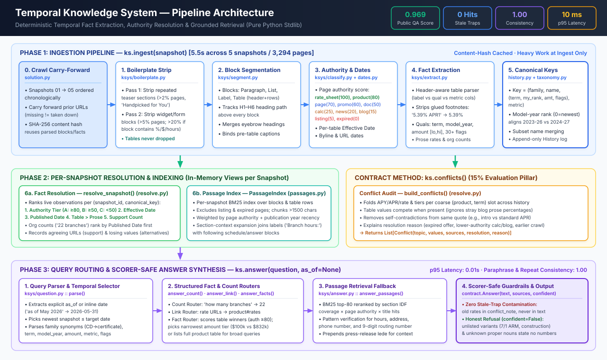

# Notes: a knowledge system that knows what's true now

Prasad MK

*(An editable 2-slide PowerPoint version of this diagram is also included in [`architecture.pptx`](architecture.pptx).)*

## How it works

The system runs entirely on the Python standard library and needs no API keys, no network access and no extra packages (`requirements.txt` is empty). An optional LLM extraction step exists (see below); it is off unless explicitly switched on, and the graded run never uses it. All heavy work happens in `ingest()`: each snapshot is cleaned, split into blocks, classified and turned into facts, and the winning value for every fact is computed per snapshot. `answer()` only reads in-memory structures, so answers take a few milliseconds and the same question always gets the same answer.

Ingest runs in six stages (code in `ksys/`):

1. **Boilerplate removal** (`boilerplate.py`). Text repeated across many pages of a snapshot (forms, widgets, chat launchers, "Handpicked for You" blog teasers) is learned from that snapshot and removed, so a teaser's date or rate is never credited to the page it sits on.
2. **Segmentation** (`segment.py`). Pages become paragraphs, lists, labels and tables, each tagged with the headings above it. Tables are parsed into header and rows, and the short line above a table becomes its caption, which usually names the product.
3. **Page classification** (`classify.py`). Each page gets a type and an authority score from general URL, title and text signals: rate sheet 100, product page 80, other first-party page 70, promotion 60, document 50, calculator 25, news 20, blog 15, listing 5, expired offer 0. Each page also gets its byline date, and every rate table gets the "Rates are effective as of" date written next to it.
4. **Fact extraction** (`extract.py`). Table cells and sentences become facts with a product, qualifiers (term, model year, balance or loan-amount tier, flags such as jumbo, special, business, Roth), a metric (APY, APR, dividend or interest rate) and a value with footnote markers removed.
5. **Keys and history** (`history.py`, `taxonomy.py`). Facts get a key that stays stable across pages and crawls even when captions are renamed or model-year buckets shift. Every observation is logged with its snapshot, page type, authority and dates.
6. **Resolution and conflicts** (`resolve.py`). For each snapshot and key, one value wins; every key that ever showed more than one value becomes a conflict entry with all values, a source per value, the winner and the reason.

## How "current" is decided

The site as of a snapshot is every page seen so far, each in its newest version (a page missing from one crawl has not necessarily been taken down). Without a date, answers come from the newest snapshot. With `as_of`, or with a date in the question such as "as of May 2026", they come from the newest snapshot taken on or before that date, and a month on its own means the end of that month.

Within a snapshot, a rate wins by these rules, in order: pages in a higher authority tier (rate sheets and product pages, then other first-party pages and promotions, then everything else), then a newer effective date, then a newer publication date, then a table value over a sentence, then the number of pages agreeing. Expired offers never win. So a stale calculator or a landing page that still lists last year's model-year table cannot beat the auto loan rate page, and a 2022 press release cannot beat a current product page. Counts such as the number of branches change over time and are restated in every press release, so for counts the newest dated statement wins.

Different qualifiers are different facts, never conflicts: 48-month vs 60-month, rate vs APY, standard vs jumbo, personal vs business, one balance tier vs another.

## How answers are built

Rate questions are matched against the winning facts of the chosen snapshot. A question that names a term, tier, model year or product gets that one value; a broad question ("what are your mortgage rates") gets the whole current table. Only current winners from tables on authoritative pages are ever stated, and replaced values are mentioned only in `conflict_note`, never in the answer text, because repeating an old value is what the scorer penalises.

Other questions (hours, addresses, routing number, links, programs) use keyword search (BM25) over page blocks and table rows, ranked by page authority, recency and how well the surrounding section covers the question. Questions about hours, addresses, phone or routing numbers must find that kind of value in the passage.

The system says "I don't know" (`confident=False`, no numbers) when the question names something the site never mentions (a branch, a product variant such as an adjustable-rate mortgage), when a rate question finds no published rate, or when nothing matches.

## Configuration and production readiness

None is needed. Optionally, a SQLite cache of extracted pages (using WAL mode for concurrency) and structured logging (`ksys.*` loggers, overridable via `KSYS_LOG_LEVEL`) can be enabled by copying `ksys.config.example.json` to `ksys.config.json`; without that file everything stays in memory and nothing is written to disk. State and the answer cache are guarded by a lock (the harness itself calls `answer()` from one thread), re-ingesting the newest snapshot does not duplicate observations, and `health()` plus a CLI (`python submission/solution.py --health`) show what was ingested and which site was detected. Design decisions are logged in `DECISIONS.md` at the repository root.

## Running and testing it

The supplied website snapshots are not in this repository. Copy the five zips from the hackathon kit into `snapshots_zip/` (see `snapshots_zip/README.md`), then run:

- Public evaluation: `python harness/run_eval.py --submission submission --eval eval/public_eval.jsonl`
- Public evaluation with a conflict check: add `--conflicts-gold tests/fixtures/conflicts_gold_public.json`
- Tests (stdlib `unittest`): `python -m unittest discover -s tests -v`

The scorer unpacks the snapshot zips on the first run. Tests that need the real snapshots skip themselves when the zips are missing; the rest run anywhere. No API keys are needed.

## How it is validated

The kit has no conflict gold for the real snapshots, so `tests/fixtures/conflicts_gold_public.json` lists the 8 contradictions the organizers label in the public questions (a current value in `must_include`, a stale one in `must_not_include`), each confirmed in the raw pages: the 30-year mortgage, 60 and 84-month auto rates, branch count, Forbes ranking, checking rate, top savings APY and the 10-month jumbo special. Against it the conflict list recovers 7 of 8 with the right winner for 5 of 8. The miss is the Forbes ranking (text facts are not compared as conflicts). Two winners are lost because folding tiers into one entry per product and term lets the scorer pair a gold item with a neighbouring term's entry (D-019). Precision against this list is 0.19, which mostly says that 8 labelled contradictions are a small sample of the 36 reported. `tests/fixtures/conflicts_baseline.json` is a snapshot of the system's own conflict list, used only to flag unintended changes; it is not ground truth.

"As of" answers are tested against timelines read by hand from each crawl's raw rate pages: the 10-month jumbo special APY (3.90% then 4.00%), the 30-year $100,000 purchase rate (5.875%, 6.250%, 6.125%, 6.375%, 7.13%) and the 48-month auto APR across the model-year rename (4.99% then 5.19%), plus date edge cases on synthetic crawls (before the first crawl, between crawls, after the last, month-only and "today" dates in the question).

## Beyond this site

Nothing in the code names Dupaco. The organisation's name and domain are read from the crawl (the suffix most page titles share, the host most pages live on) and used wherever the code would otherwise name one credit union. `tests/test_second_site.py` runs the system on a made-up second credit union whose pages differ in the ways that broke earlier versions: tables without a caption line, a news folder named after the organisation, links written without a scheme. One limit remains by design: counts go to the newest dated statement, so a current figure that only appears on an undated page loses to an older dated one. Trusting undated pages instead would make Dupaco's correct 22 branches lose to an old staff biography on `/about` that says 18.

## Optional LLM extraction (off by default)

Rules read tables well and prose less well. When several products share one sentence ("Holiday Club Savings earns 1.25% APY, Youth Savings earns 2.00% APY, and a Health Savings Account earns 0.50% APY"), when values sit on their own lines under labels, or when a range sits next to an intro rate, the rules can credit a value to the wrong product. `ksys/llm.py` can ask Gemini to extract the rates from such pages at ingest. It runs only on pages that state rates in text but have no rate table, and only when all three are set: `KSYS_LLM=gemini`, `GOOGLE_API_KEY`, and `KSYS_LLM_ALLOW_DOMAINS` listing the site's domain. With no allow list nothing is sent, whatever keys are in the environment.

The model's output is not trusted as such. A value is kept only if it appears in the page and inside the quoted sentence, and the quote itself appears in the page; anything else is dropped. Kept values rank like prose, below any table on an authoritative page, and replace that page's rule-based prose rates. Calls use temperature 0 and a JSON schema; responses are cached in `submission/cache/llm/` (gitignored) by model, prompt version, URL and page content, so a rerun makes no calls and gives identical facts. Network or parsing failures are logged and the page keeps its rule-based facts. `answer()` never calls a model.

How it was tested: the supplied snapshots were never sent to an API. Testing used a free-tier Gemini key, and free-tier prompts may be used by Google, which the kit's "shared for this event only" terms rule out for the credit union's pages. So the live test runs on `tests/fixtures/hard_layouts.py`, a made-up credit union with those three layouts and seven questions with known answers. `tools/check_llm.py` (needs `GOOGLE_API_KEY`) reports, for `gemini-3.5-flash`: rules alone 1 of 7, two of them confident wrong answers (another product's rate, the balance-transfer rate as the purchase APR); with the model 7 of 7, 7 values kept and none rejected; two fresh runs gave identical facts; a cached rerun made no calls and matched. `tests/test_llm_extract.py` covers the guards, the grounding check, the cache and API failure offline with a stand-in for the model, so it needs no key. On the real snapshots with the step switched on and only the made-up domain allowed, no page was offered to the model, and the public evaluation is unchanged at 0.969.

What this does not show: how much it would help on the real snapshots, which would need a paid key (or an equivalent agreement) before any page is sent. The model defaults to `gemini-3.5-flash`; `KSYS_LLM_MODEL` overrides it.
